# PPDB Online SMK Nusantara (Bagian 1: Fitur Dasar)

**PPDB Online SMK Nusantara** adalah aplikasi web Penerimaan Peserta Didik Baru yang dibangun dengan **PHP** dan **MySQL**. Proyek ini dibagi menjadi dua bagian. Dokumen ini menjelaskan **Bagian 1 (versi awal)**, yaitu fitur inti yang membuat alur pendaftaran dasar sudah dapat berjalan: calon siswa membuat akun, mengisi biodata, memilih jurusan, dan memantau status, sedangkan admin mengelola data siswa dan jurusan serta memverifikasi pendaftaran. Bagian 2 (versi lengkap) menambahkan unggah berkas, kuota, seleksi, pengumuman, riwayat status, laporan, dan pengaturan.

Pembagian ini mengikuti tahap pengembangan MVP pada dokumen PRD, yaitu **Tahap 1 (Fitur Dasar)** untuk bagian awal dan **Tahap 2 (Pengembangan Lanjutan)** untuk bagian akhir.

Tampilan mengusung suasana bersih dan profesional, dengan warna **biru** sebagai warna utama dan **putih bersih** sebagai warna pendukung.

## 1. Tujuan

Bagian 1 dibuat untuk:

* menerapkan arsitektur 3 tier (HTML/CSS/Bootstrap, PHP, dan MySQL) dalam satu aplikasi web;
* menyediakan registrasi dan login dengan pengalihan sesuai role (admin dan calon siswa);
* menyimpan biodata calon siswa dan pilihan jurusan secara terstruktur di MySQL;
* menyediakan CRUD data jurusan dan pengelolaan data siswa bagi admin;
* menyediakan dashboard admin dan proses verifikasi status pendaftaran;
* menerapkan pengamanan dasar: hash password, prepared statement, token CSRF, dan otorisasi role.

## 2. Ruang Lingkup Bagian 1

| Fitur (PRD Tahap 1)                | Keterangan pada Bagian 1                                              |
| ---------------------------------- | --------------------------------------------------------------------- |
| Registrasi dan login               | Ada, dengan hash password dan pengalihan sesuai role                  |
| Pengelolaan biodata siswa          | Ada: calon siswa mengisi dan memperbarui biodata sendiri              |
| Pengelolaan jurusan                | Ada: tambah, ubah, aktif/nonaktif, dan hapus                          |
| Formulir pendaftaran               | Ada: memilih jurusan dan mendapat nomor pendaftaran                   |
| Penyimpanan data ke MySQL          | Ada: empat tabel berelasi                                             |
| CRUD data siswa                    | Ada: siswa menambah dan mengubah biodata, admin melihat, mencari, dan menghapus |
| Dashboard admin                    | Ada: statistik pendaftar per status dan per jurusan                   |
| Verifikasi status pendaftaran      | Ada: Menunggu, Diverifikasi, dan Ditolak dengan catatan admin         |

Fitur yang **belum** ada pada Bagian 1 dan baru ditambahkan di Bagian 2 (PRD Tahap 2):

| Fitur                              | Dikerjakan pada  |
| ---------------------------------- | ---------------- |
| Upload dokumen persyaratan         | Bagian 2         |
| Kuota jurusan                      | Bagian 2         |
| Seleksi (status Diterima) dan pengumuman hasil | Bagian 2 |
| Riwayat perubahan status           | Bagian 2         |
| Cetak bukti pendaftaran            | Bagian 2         |
| Laporan dan ekspor CSV             | Bagian 2         |
| Pengaturan tahun ajaran dan periode dari dashboard | Bagian 2 |

Pada Bagian 1, tahun ajaran dan jadwal PPDB masih berupa konstanta di `includes/functions.php`.

## 3. Konsep dan Tema

Palet warna yang digunakan:

| Warna        | Kode      | Penggunaan                                              |
| ------------ | --------- | ------------------------------------------------------- |
| Putih        | `#FFFFFF` | Latar halaman dan kartu                                 |
| Biru royal   | `#1A45A0` | Warna utama: logo, tombol, menu aktif, judul, statistik |
| Biru tua     | `#123578` | Footer dan hover tombol                                 |
| Biru langit  | `#87CEEB` | Gradasi hero, garis aksen                               |
| Biru muda    | `#F2F7FD` | Latar sidebar dan section selang-seling                 |

Jenis huruf yang digunakan adalah **Plus Jakarta Sans** dari Google Fonts.

## 4. Fitur Website

### A. Halaman Pengunjung

* **Beranda** (`index.php`): navbar dengan logo, hero dengan foto sekolah yang memudar ke latar biru, tiga kartu jadwal PPDB, daftar program keahlian dari database, persyaratan pendaftaran, dan footer.
* **Registrasi** (`register.php`) dan **Login** (`login.php`).

**Tangkapan layar:**

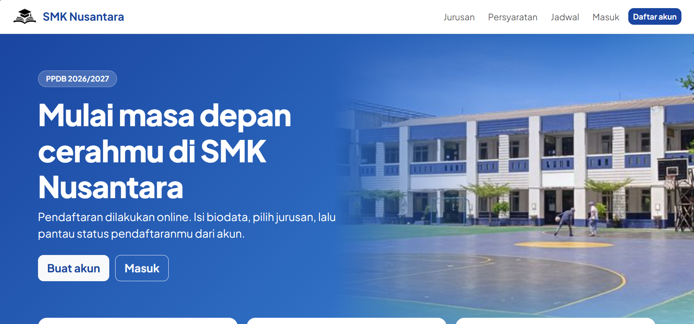

*Gambar 1. Bagian navbar dan hero*

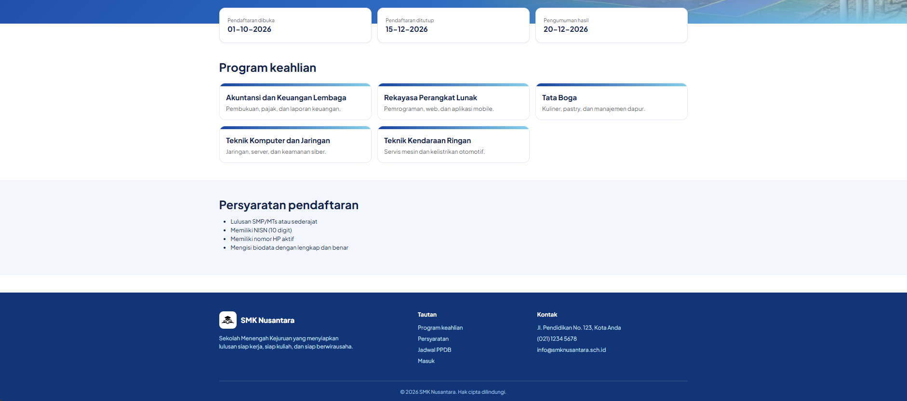

*Gambar 2. Jadwal PPDB, program keahlian, dan footer*

### B. Registrasi dan Login

Setelah login, **admin** diarahkan ke Dashboard Admin dan **calon siswa** ke Dashboard Siswa.

Aturan validasi pada halaman registrasi:

| Kolom               | Aturan                                     |
| ------------------- | ------------------------------------------ |
| Nama lengkap        | Wajib diisi, maksimal 100 karakter         |
| Email               | Wajib diisi, format valid, dan harus unik  |
| Password            | Wajib diisi, minimal 6 karakter            |
| Konfirmasi password | Wajib diisi dan harus sama dengan password |

Pada halaman login, email dan password wajib diisi dan dicocokkan dengan hash di database menggunakan `password_verify()`. Validasi dasar sisi klien memakai atribut HTML5, sedangkan validasi utama dilakukan di sisi server.

**Tangkapan layar:**

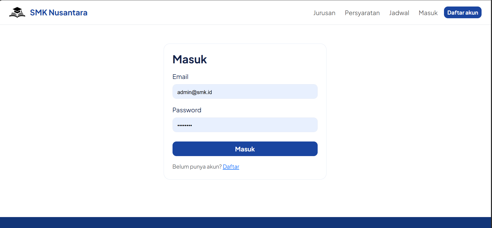

*Gambar 3. Halaman login*

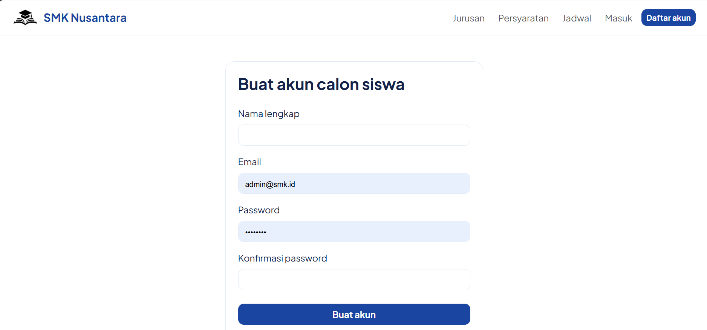

*Gambar 4. Halaman registrasi*

### C. Dashboard Calon Siswa

* **Dashboard** (`siswa/dashboard.php`): nomor pendaftaran, status, jurusan pilihan, petunjuk langkah berikutnya, dan jadwal.
* **Biodata** (`siswa/biodata.php`): form pengisian dan pembaruan data diri.
* **Pendaftaran** (`siswa/pendaftaran.php`): memilih jurusan dan mengirim pendaftaran. Nomor pendaftaran dibuat otomatis dengan format `PPDB-TAHUN-0001`.
* **Status pendaftaran** (`siswa/status.php`): melihat status verifikasi dan catatan admin.

Aturan validasi pada form biodata:

| Kolom         | Aturan                                         |
| ------------- | ---------------------------------------------- |
| NISN          | Wajib 10 digit angka dan harus unik            |
| Nama lengkap  | Wajib diisi                                    |
| Jenis kelamin | Wajib dipilih                                  |
| Tempat lahir  | Wajib diisi                                    |
| Tanggal lahir | Wajib diisi dengan tanggal yang valid          |
| Alamat        | Wajib diisi                                    |
| Asal sekolah  | Wajib diisi                                    |
| Nomor HP      | Wajib diisi, diawali `08`, panjang 10-14 digit |

Aturan pada pendaftaran: biodata harus lengkap, jurusan yang dipilih harus aktif, dan satu siswa hanya dapat mendaftar satu kali per tahun ajaran. Biodata terkunci setelah status pendaftaran tidak lagi "Menunggu".

**Tangkapan layar:**

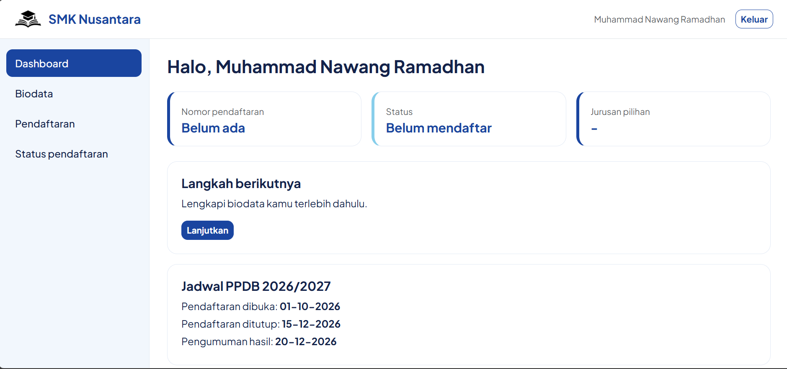

*Gambar 5. Dashboard calon siswa*

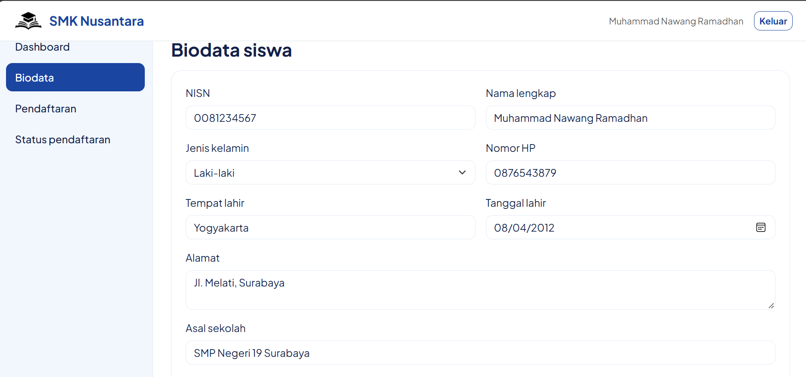

*Gambar 6. Form biodata siswa*

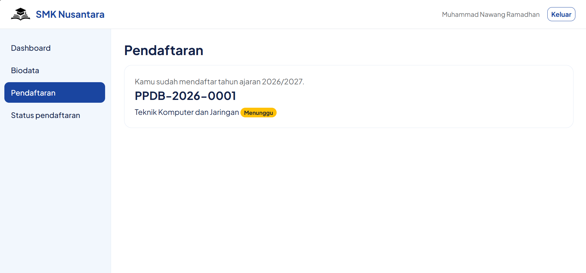

*Gambar 7. Pemilihan jurusan*

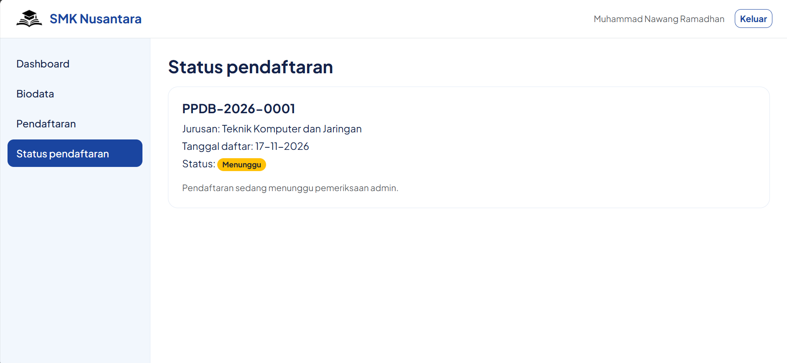

*Gambar 8. Status pendaftaran*

### D. Dashboard Admin

* **Dashboard** (`admin/dashboard.php`): jumlah pendaftar per status (Menunggu, Diverifikasi, Ditolak), jumlah data siswa, dan jumlah pendaftar per jurusan.
* **Data siswa** (`admin/siswa.php`): daftar calon siswa dengan pencarian nama atau NISN dan tombol Hapus.
* **Data jurusan** (`admin/jurusan.php`): menambah, mengubah, mengaktifkan atau menonaktifkan, dan menghapus jurusan.
* **Pendaftaran & verifikasi** (`admin/pendaftaran.php`): daftar pendaftar dengan pencarian dan filter status. Halaman detail menampilkan biodata, kolom catatan, dan tombol Verifikasi, Tolak, atau Kembalikan ke Menunggu.

Aturan pada sisi admin:

| Fitur         | Aturan                                                                          |
| ------------- | ------------------------------------------------------------------------------- |
| Jurusan       | Kode dan nama wajib diisi; kode harus unik                                      |
| Hapus jurusan | Jurusan yang sudah dipilih pendaftar tidak dapat dihapus, cukup dinonaktifkan   |
| Hapus siswa   | Siswa yang sudah memiliki pendaftaran tidak dapat dihapus                       |
| Verifikasi    | Status hanya dapat diubah oleh admin dan harus berupa Menunggu, Diverifikasi, atau Ditolak |

**Tangkapan layar:**

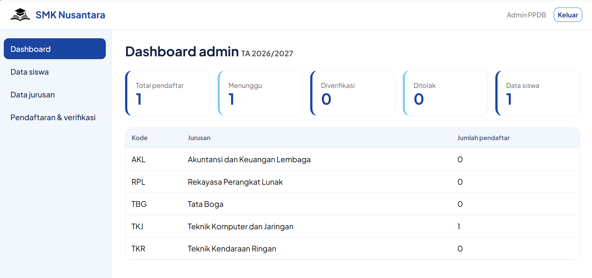

*Gambar 9. Dashboard admin*

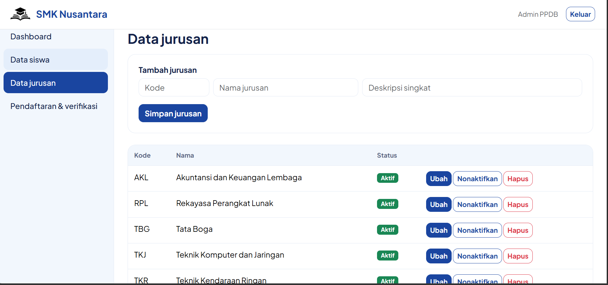

*Gambar 10. Pengelolaan data jurusan*

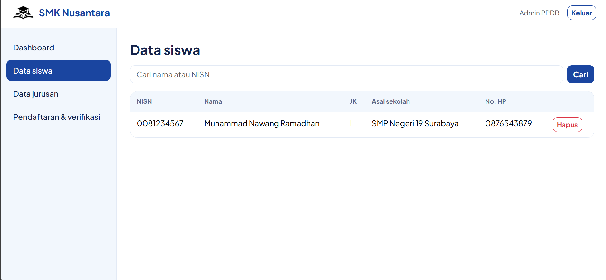

*Gambar 11. Daftar pendaftar dengan pencarian dan filter*

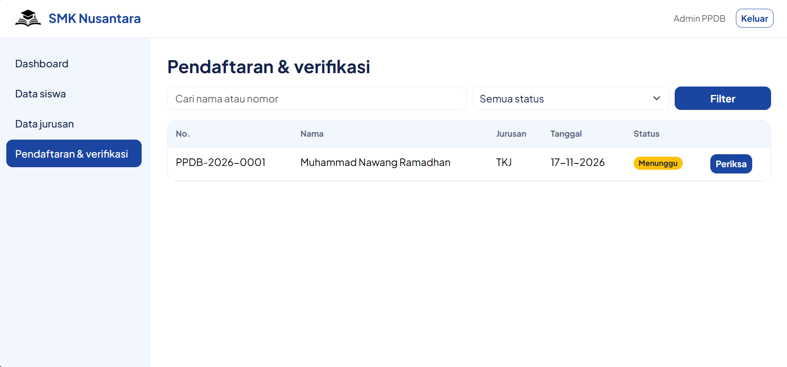

*Gambar 12. Detail pendaftar dan verifikasi*

### E. Tampilan Responsif

Seluruh halaman menyesuaikan ukuran layar menggunakan sistem grid Bootstrap. Pada layar kecil, navbar berubah menjadi hamburger, foto hero menjadi latar tipis di belakang teks, sidebar menjadi menu horizontal yang dapat digeser, dan tabel dapat digulir ke samping.

<p align="center">
  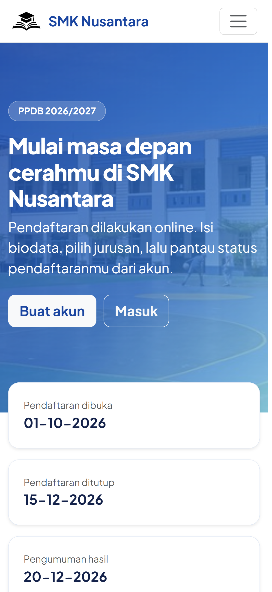
</p>

*Gambar 13. Tampilan beranda pada layar kecil*

### F. Keamanan

* password disimpan dalam bentuk hash dengan `password_hash()` dan diperiksa dengan `password_verify()`;
* seluruh query memakai **prepared statements (PDO)** untuk mencegah SQL injection;
* seluruh teks yang ditampilkan di-escape dengan `htmlspecialchars` untuk mencegah XSS;
* setiap form yang mengubah data dilindungi **token CSRF**;
* session dibuat ulang saat login (`session_regenerate_id`) dan dihapus saat logout;
* hak akses dibatasi berdasarkan role, sehingga siswa tidak dapat membuka halaman admin dan sebaliknya;
* pembuatan nomor pendaftaran memakai **transaksi database**.

## 5. Alur Penggunaan

Alur calon siswa:

```text
Membuka Halaman Beranda
          ↓
Membuat Akun (Registrasi)
          ↓
Login
          ↓
Mengisi Biodata
          ↓
Memilih Jurusan dan Mengirim Pendaftaran
          ↓
Menerima Nomor Pendaftaran
          ↓
Memantau Status Verifikasi
```

Alur admin:

```text
Login sebagai Admin
          ↓
Melihat Statistik di Dashboard
          ↓
Mengelola Data Jurusan
          ↓
Memeriksa Biodata Pendaftar
          ↓
Verifikasi atau Tolak (dengan catatan)
          ↓
Calon Siswa Melihat Status Terbaru
```

## 6. Struktur Halaman

| Halaman                  | Berkas                  | Fungsi                                         |
| ------------------------ | ----------------------- | ---------------------------------------------- |
| Beranda                  | `index.php`             | Informasi sekolah, jadwal, jurusan, persyaratan |
| Registrasi               | `register.php`          | Membuat akun calon siswa                       |
| Login                    | `login.php`             | Masuk admin dan calon siswa                    |
| Logout                   | `logout.php`            | Mengakhiri session                             |
| Dashboard siswa          | `siswa/dashboard.php`   | Ringkasan pendaftaran                          |
| Biodata                  | `siswa/biodata.php`     | Mengisi dan memperbarui biodata                |
| Pendaftaran              | `siswa/pendaftaran.php` | Memilih jurusan dan mengirim pendaftaran       |
| Status pendaftaran       | `siswa/status.php`      | Melihat status dan catatan admin               |
| Dashboard admin          | `admin/dashboard.php`   | Statistik pendaftar                            |
| Data siswa               | `admin/siswa.php`       | Melihat, mencari, dan menghapus siswa          |
| Data jurusan             | `admin/jurusan.php`     | CRUD jurusan                                   |
| Pendaftaran & verifikasi | `admin/pendaftaran.php` | Daftar pendaftar dan verifikasi status         |

## 7. Struktur Database

Database bernama `db_ppdb_smk_awal` memiliki empat tabel dengan mesin InnoDB dan karakter `utf8mb4`.

**Tabel `users`**

| Field      | Tipe                  | Keterangan   |
| ---------- | --------------------- | ------------ |
| id_user    | INT (PK, AI)          | ID pengguna  |
| nama       | VARCHAR(100)          | Nama lengkap |
| email      | VARCHAR(120), unik    | Nama login   |
| password   | VARCHAR(255)          | Hash         |
| role       | ENUM('admin','siswa') | Hak akses    |
| created_at | TIMESTAMP             | Waktu dibuat |

**Tabel `siswa`**

| Field         | Tipe                           | Keterangan                 |
| ------------- | ------------------------------ | -------------------------- |
| id_siswa      | INT (PK, AI)                   | ID siswa                   |
| id_user       | INT (FK → users.id_user), unik | Pemilik biodata            |
| nisn          | CHAR(10), unik                 | Nomor induk siswa nasional |
| nama_lengkap  | VARCHAR(100)                   | Nama siswa                 |
| jenis_kelamin | ENUM('L','P')                  | Jenis kelamin              |
| tempat_lahir  | VARCHAR(60)                    | Tempat lahir               |
| tanggal_lahir | DATE                           | Tanggal lahir              |
| alamat        | TEXT                           | Alamat                     |
| asal_sekolah  | VARCHAR(100)                   | Asal SMP/MTs               |
| no_hp         | VARCHAR(15)                    | Nomor HP                   |

**Tabel `jurusan`**

| Field        | Tipe              | Keterangan            |
| ------------ | ----------------- | --------------------- |
| id_jurusan   | INT (PK, AI)      | ID jurusan            |
| kode_jurusan | VARCHAR(10), unik | Kode (RPL, TKJ, dst.) |
| nama_jurusan | VARCHAR(100)      | Nama jurusan          |
| deskripsi    | VARCHAR(255)      | Deskripsi singkat     |
| aktif        | TINYINT(1)        | 1 aktif, 0 nonaktif   |

**Tabel `pendaftaran`**

| Field          | Tipe                                    | Keterangan        |
| -------------- | --------------------------------------- | ----------------- |
| id_pendaftaran | INT (PK, AI)                            | ID pendaftaran    |
| no_pendaftaran | VARCHAR(20), unik                       | Nomor pendaftaran |
| id_siswa       | INT (FK → siswa.id_siswa)               | Pendaftar         |
| id_jurusan     | INT (FK → jurusan.id_jurusan)           | Jurusan pilihan   |
| tahun_ajaran   | VARCHAR(9)                              | Contoh 2026/2027  |
| tanggal_daftar | DATETIME                                | Waktu mendaftar   |
| status         | ENUM('Menunggu','Diverifikasi','Ditolak') | Status pendaftaran |
| catatan        | TEXT                                    | Catatan admin     |

Relasi antartabel:

```text
users (1) ──── (1) siswa (1) ────< (N) pendaftaran (N) >──── (1) jurusan
```

Satu akun memiliki satu biodata, satu siswa dapat memiliki pendaftaran (satu per tahun ajaran), dan satu jurusan dapat dipilih banyak pendaftaran. Biodata ikut terhapus saat akun dihapus (`ON DELETE CASCADE`), sedangkan siswa dan jurusan yang sudah memiliki pendaftaran tidak dapat dihapus (`ON DELETE RESTRICT`). Kombinasi `id_siswa` dan `tahun_ajaran` bersifat unik.

Pada Bagian 2, database ini dikembangkan dengan menambah kolom `kuota` pada `jurusan`, status `Diterima` pada `pendaftaran`, serta tabel `berkas`, `riwayat_status`, dan `pengaturan`.

**Tangkapan layar:**

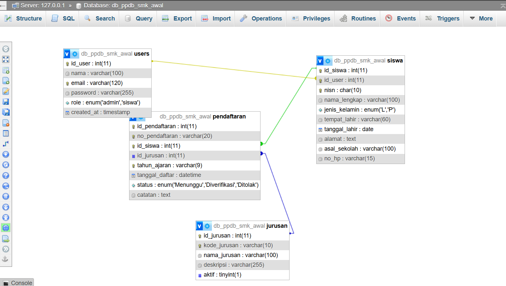

*Gambar 14. ERD database db_ppdb_smk_awal*

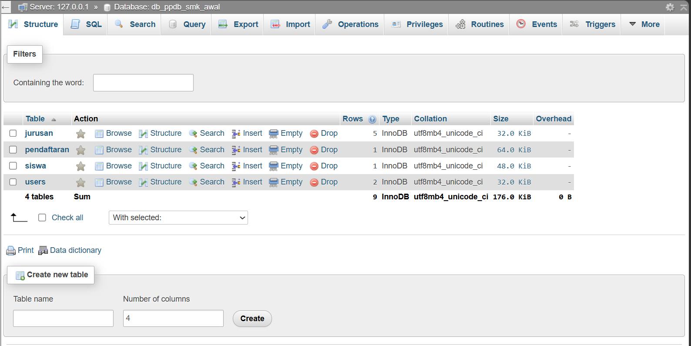

*Gambar 15. Daftar tabel pada phpMyAdmin*

## 8. Arsitektur 3 Tier

| Lapisan                            | Teknologi                          | Peran                                                                     |
| ---------------------------------- | ---------------------------------- | ------------------------------------------------------------------------- |
| Presentation Layer                 | HTML, CSS, Bootstrap 5, JavaScript | Tampilan halaman, layout responsif, dan validasi dasar sisi klien         |
| Application Layer (Business Logic) | PHP                                | Autentikasi, session, otorisasi role, CRUD, dan validasi server           |
| Data Layer                         | MySQL (PDO)                        | Penyimpanan pengguna, biodata, jurusan, dan pendaftaran                   |

## 9. Struktur File

```text
ppdb_smk_awal/
├── index.php             # beranda
├── login.php             # halaman login
├── register.php          # halaman registrasi
├── logout.php            # keluar
├── database.sql          # struktur dan data awal database
├── config/
│   └── database.php      # koneksi database (PDO)
├── includes/
│   ├── functions.php     # fungsi bantu, session, CSRF, otorisasi, dan konstanta PPDB
│   └── layout.php        # navbar, sidebar, dan footer
├── siswa/
│   ├── dashboard.php     # ringkasan pendaftaran
│   ├── biodata.php       # form biodata
│   ├── pendaftaran.php   # pemilihan jurusan
│   └── status.php        # status pendaftaran
├── admin/
│   ├── dashboard.php     # statistik
│   ├── siswa.php         # data siswa
│   ├── jurusan.php       # CRUD jurusan
│   └── pendaftaran.php   # verifikasi status
├── assets/
│   ├── css/style.css     # warna tema dan gaya tampilan
│   └── images/           # logo.png dan hero.jpg
├── screenshots/          # tangkapan layar untuk dokumentasi
└── README.md             # dokumentasi proyek
```

## 10. Teknologi yang Digunakan

* **HTML dan CSS**: struktur halaman, palet warna, dan efek foto hero yang menyatu dengan latar;
* **Bootstrap 5.3.3**: sistem grid, komponen, dan tampilan responsif;
* **JavaScript**: bagian interaktif bawaan Bootstrap (menu hamburger dan notifikasi yang dapat ditutup);
* **PHP**: logika aplikasi, autentikasi, dan CRUD;
* **MySQL dan PDO**: penyimpanan data, dikelola melalui phpMyAdmin;
* **XAMPP (Apache dan MySQL)**: menjalankan website di komputer lokal;
* **Google Fonts**: jenis huruf Plus Jakarta Sans;
* **Visual Studio Code**: penulisan kode.

## 11. Menjalankan Website

1. Jalankan **Apache** dan **MySQL** dari XAMPP Control Panel.
2. Salin folder `ppdb_smk_awal` ke `C:\xampp\htdocs\`.
3. Buka `http://localhost/phpmyadmin`, klik tab **Import**, pilih berkas `database.sql`, lalu klik **Import**. Database `db_ppdb_smk_awal` beserta empat tabelnya akan terbentuk.
4. Buka `config/database.php` dan sesuaikan `DB_USER` dan `DB_PASS` jika berbeda (secara bawaan `root` dan kosong). Jika nama folder bukan `ppdb_smk_awal`, ubah `BASE_URL` pada `includes/functions.php`.
5. Letakkan `logo.png` dan `hero.jpg` pada folder `assets/images/`.
6. Buka `http://localhost/ppdb_smk_awal/` untuk beranda dan `http://localhost/ppdb_smk_awal/login.php` untuk masuk.

Website memerlukan koneksi internet karena Bootstrap dan font dimuat melalui CDN.

Akun untuk uji coba:

| Email                 | Password   | Role        |
| --------------------- | ---------- | ----------- |
| `admin@smk.id`        | `admin123` | Admin       |
| `nawangramadhan@gmail.com` | `nawang123`    | Calon siswa |

Password akun admin bawaan sebaiknya segera diganti setelah aplikasi dipakai.

## 12. Pengujian

| No | Pengujian         | Kriteria Keberhasilan              | Hasil |
| -- | ----------------- | ---------------------------------- | ----- |
| 1  | Registrasi        | Akun berhasil disimpan ke MySQL    | ✅    |
| 2  | Login             | Pengguna diarahkan sesuai role     | ✅     |
| 3  | Biodata           | Data siswa berhasil disimpan       | ✅     |
| 4  | Pemilihan jurusan | Jurusan tersedia dan dapat dipilih | ✅     |
| 5  | Pendaftaran       | Nomor pendaftaran berhasil dibuat  | ✅     |
| 6  | CRUD jurusan      | Admin dapat menambah, mengubah, dan menghapus jurusan | ✅ |
| 7  | Verifikasi        | Admin dapat mengubah status        | ✅     |
| 8  | Dashboard         | Statistik sesuai data database     | ✅     |

## 13. Pengembangan pada Bagian 2

Bagian 2 melanjutkan proyek ini sesuai PRD Tahap 2: unggah dokumen persyaratan, kuota jurusan, seleksi dan pengumuman hasil, riwayat perubahan status, cetak bukti pendaftaran, laporan dengan ekspor CSV, serta pengaturan tahun ajaran dan periode dari dashboard. 

## 14. Kredit

* Rancangan dan spesifikasi sistem: dokumen *Product Requirements Document PPDB Online SMK Nusantara* pada mata kuliah Web Back End.
* Palet warna: referensi gambar *Education & Learning Gradient Palette*.
* Foto hero: Didapatkan dari Internet.
* Logo: Didapatkan dari Internet.
* Jenis huruf: Plus Jakarta Sans melalui Google Fonts.
* Framework: Bootstrap 5.3.3.
