# PPDB Online SMK Nusantara

**PPDB Online SMK Nusantara** adalah aplikasi web Penerimaan Peserta Didik Baru yang memungkinkan calon siswa mendaftar secara daring, sedangkan admin sekolah memverifikasi pendaftaran, mengelola seleksi, dan membuat laporan melalui dashboard. Website ini dibuat sebagai tugas proyek mata kuliah **Web Back End** dengan arsitektur tiga lapis (3 tier), yaitu HTML/CSS/JavaScript dengan Bootstrap 5 sebagai lapisan tampilan, PHP sebagai lapisan logika bisnis, dan MySQL sebagai lapisan data.

Tampilan SMK Nusantara mengusung suasana bersih, profesional, dan tepercaya, dengan warna biru royal sebagai warna utama, putih bersih sebagai warna pendukung, serta aksen biru langit yang segar.

## 1. Tujuan

Website ini dibuat untuk:

* menerapkan arsitektur 3 tier (Presentation Layer, Application Layer, dan Data Layer) dalam satu aplikasi web;
* menyediakan halaman informasi PPDB untuk pengunjung, meliputi beranda, program keahlian, persyaratan, dan jadwal;
* menyediakan alur pendaftaran bagi calon siswa, mulai dari registrasi, pengisian biodata, pemilihan jurusan, hingga unggah berkas;
* menyediakan dashboard admin untuk mengelola data siswa, jurusan, verifikasi, seleksi, laporan, dan pengaturan;
* menerapkan autentikasi, manajemen session, otorisasi berdasarkan role, validasi form, serta unggah berkas yang aman;
* menyimpan seluruh data pada database MySQL dengan relasi antartabel;
* menghasilkan tampilan website yang bersih, responsif, dan mudah digunakan.

## 2. Konsep dan Tema

Konsep SMK Nusantara adalah layanan pendaftaran yang jelas langkahnya dan tidak membingungkan. Calon siswa selalu tahu tahap yang sedang dijalani, sedangkan admin mendapat ringkasan data yang mudah dibaca. Warna biru dipilih karena memberi kesan tepercaya dan sesuai dengan identitas sekolah, sedangkan latar putih menjaga tampilan tetap lega.

Palet warna yang digunakan:

| Warna        | Kode      | Penggunaan                                              |
| ------------ | --------- | ------------------------------------------------------- |
| Putih        | `#FFFFFF` | Latar halaman dan kartu                                 |
| Biru royal   | `#1A45A0` | Warna utama: logo, tombol, menu aktif, judul, statistik |
| Biru tua     | `#123578` | Footer dan hover tombol                                 |
| Biru langit  | `#87CEEB` | Gradasi hero, garis aksen, dan progress bar             |
| Biru muda    | `#F2F7FD` | Latar sidebar dan section selang-seling                 |

Palet dasar mengacu pada gambar *Education & Learning Gradient Palette*, dengan biru sebagai prioritas utama dan putih sebagai prioritas kedua. Jenis huruf yang digunakan adalah **Plus Jakarta Sans**.

## 3. Fitur Website

### A. Halaman Pengunjung

Halaman yang dapat diakses tanpa login:

* **Beranda** (`index.php`): berisi navbar dengan logo dan menu, hero dengan foto sekolah yang memudar ke latar biru, tiga kartu jadwal PPDB, daftar program keahlian beserta kuota, daftar persyaratan dokumen, dan footer. Tanggal jadwal, jurusan, dan kuota diambil langsung dari database.
* **Registrasi** (`register.php`): pembuatan akun calon siswa.
* **Login** (`login.php`): masuk ke akun, dengan pengalihan otomatis sesuai role.

Pengunjung yang sudah login tetap dapat membuka beranda tanpa tampilan sidebar dashboard.

**Tangkapan layar:**

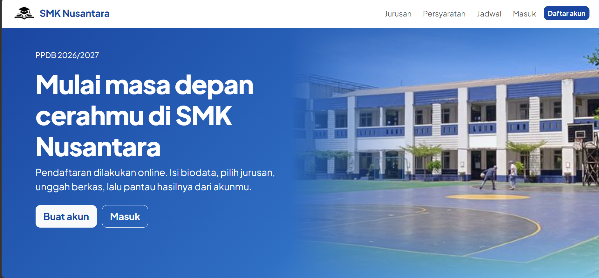

*Gambar 1. Bagian navbar dan hero dengan foto yang menyatu dengan latar*

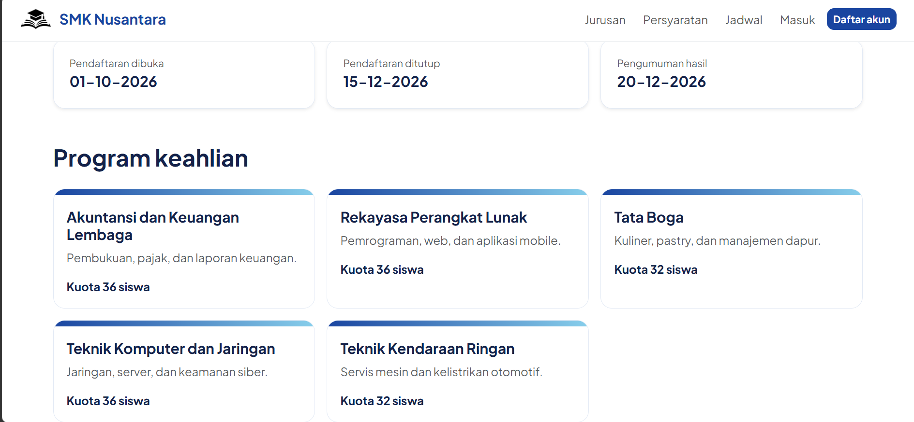

*Gambar 2. Kartu jadwal PPDB dan program keahlian*

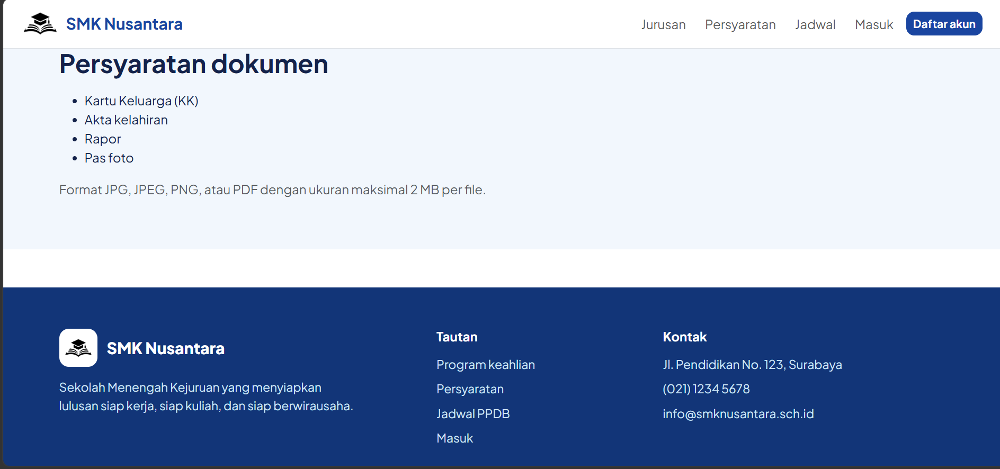

*Gambar 3. Persyaratan dokumen dan footer*

### B. Halaman Login dan Registrasi

Halaman login digunakan admin dan calon siswa untuk masuk ke akun. Setelah berhasil, **admin** diarahkan ke Dashboard Admin dan **calon siswa** ke Dashboard Siswa. Halaman registrasi digunakan calon siswa untuk membuat akun baru.

Aturan validasi pada halaman login:

| Kolom    | Aturan                                                                                  |
| -------- | --------------------------------------------------------------------------------------- |
| Email    | Wajib diisi dengan format email valid                                                   |
| Password | Wajib diisi; dicocokkan dengan hash di database menggunakan `password_verify()`         |

Aturan validasi pada halaman registrasi:

| Kolom               | Aturan                                     |
| ------------------- | ------------------------------------------ |
| Nama lengkap        | Wajib diisi, maksimal 100 karakter         |
| Email               | Wajib diisi, format valid, dan harus unik  |
| Password            | Wajib diisi, minimal 6 karakter            |
| Konfirmasi password | Wajib diisi dan harus sama dengan password |

Validasi dasar dilakukan di sisi klien melalui atribut HTML5 (`required`, `type="email"`, `minlength`), sedangkan validasi utama dilakukan di sisi server. Pesan kesalahan ditampilkan dalam kotak berwarna merah, dan akun baru disimpan dengan password yang di-hash menggunakan `password_hash()`.

**Tangkapan layar:**

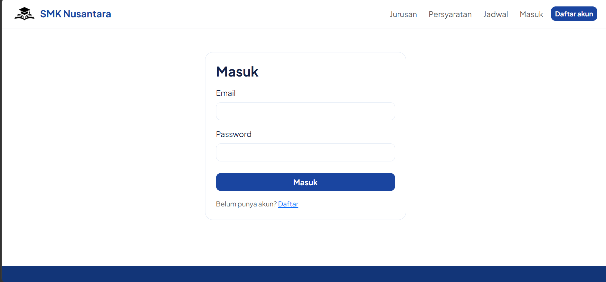

*Gambar 4. Halaman login*

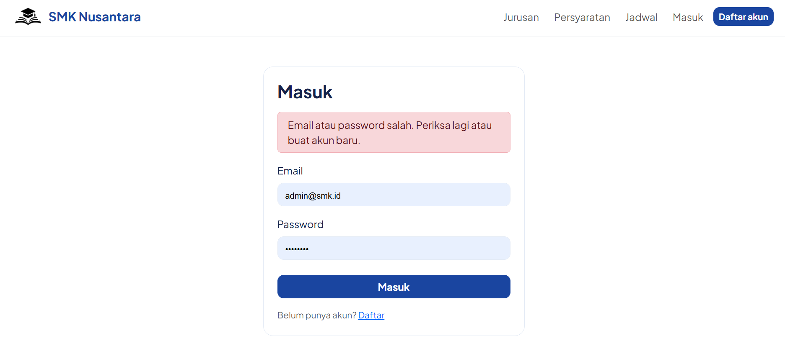

*Gambar 5. Pesan kesalahan pada halaman login*

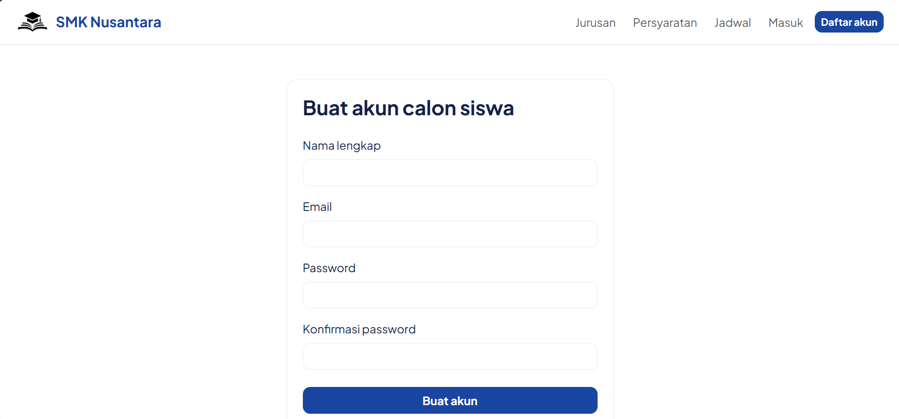

*Gambar 6. Halaman registrasi*

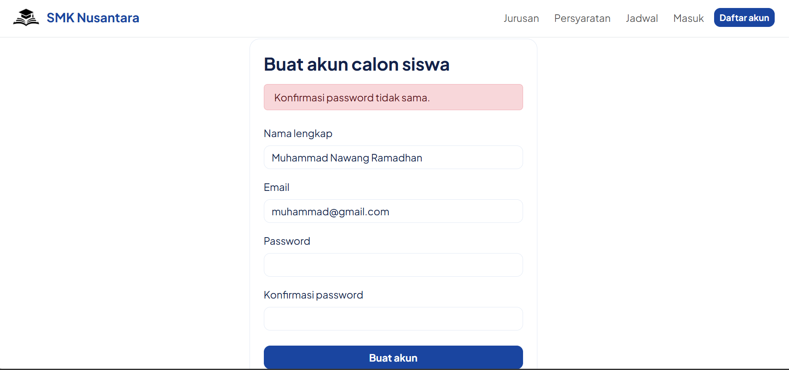

*Gambar 7. Pesan validasi pada halaman registrasi*

### C. Dashboard Calon Siswa

Setelah login, calon siswa masuk ke dashboard dengan menu samping (sidebar):

* **Dashboard** (`siswa/dashboard.php`): menampilkan nomor pendaftaran, status, jurusan pilihan, petunjuk langkah berikutnya, dan jadwal PPDB.
* **Biodata** (`siswa/biodata.php`): form pengisian dan pembaruan data diri.
* **Pendaftaran** (`siswa/pendaftaran.php`): memilih jurusan dan mengirim pendaftaran. Setelah terkirim, sistem membuat nomor pendaftaran otomatis dengan format `PPDB-TAHUN-0001`.
* **Upload berkas** (`siswa/berkas.php`): mengunggah KK, akta kelahiran, rapor, dan pas foto.
* **Status & pengumuman** (`siswa/status.php`): melihat status verifikasi, catatan admin, riwayat perubahan status, dan hasil seleksi.
* **Cetak bukti** (`siswa/cetak.php`): halaman bukti pendaftaran yang siap dicetak.

Aturan validasi pada form biodata:

| Kolom         | Aturan                                         |
| ------------- | ---------------------------------------------- |
| NISN          | Wajib 10 digit angka dan harus unik            |
| Nama lengkap  | Wajib diisi                                    |
| Jenis kelamin | Wajib dipilih (Laki-laki atau Perempuan)       |
| Tempat lahir  | Wajib diisi                                    |
| Tanggal lahir | Wajib diisi dengan tanggal yang valid          |
| Alamat        | Wajib diisi                                    |
| Asal sekolah  | Wajib diisi                                    |
| Nomor HP      | Wajib diisi, diawali `08`, panjang 10–14 digit |

Aturan pada pendaftaran dan unggah berkas:

| Fitur         | Aturan                                                                                              |
| ------------- | --------------------------------------------------------------------------------------------------- |
| Pendaftaran   | Biodata harus lengkap, dikirim pada periode PPDB, memilih jurusan aktif, dan satu kali per tahun ajaran |
| Upload berkas | Format JPG, JPEG, PNG, atau PDF; maksimal 2 MB per file; tipe file diperiksa dari isi file          |
| Penguncian    | Biodata dan berkas tidak dapat diubah setelah pendaftaran masuk tahap verifikasi                    |
| Pengumuman    | Hasil Diterima atau Ditolak baru tampil setelah admin mengaktifkan pengumuman                       |

**Tangkapan layar:**

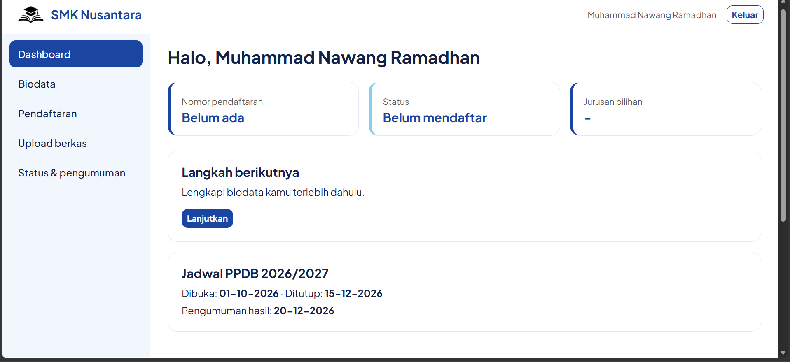

*Gambar 8. Dashboard calon siswa*

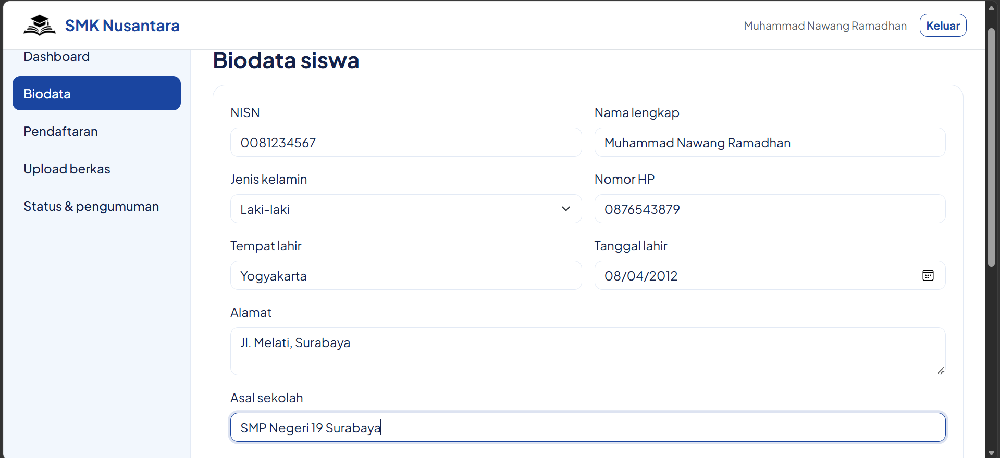

*Gambar 9. Form biodata siswa*

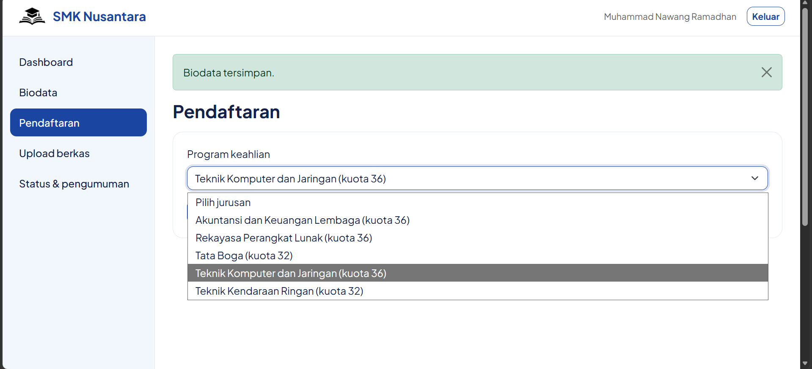

*Gambar 10. Pemilihan jurusan dan nomor pendaftaran*

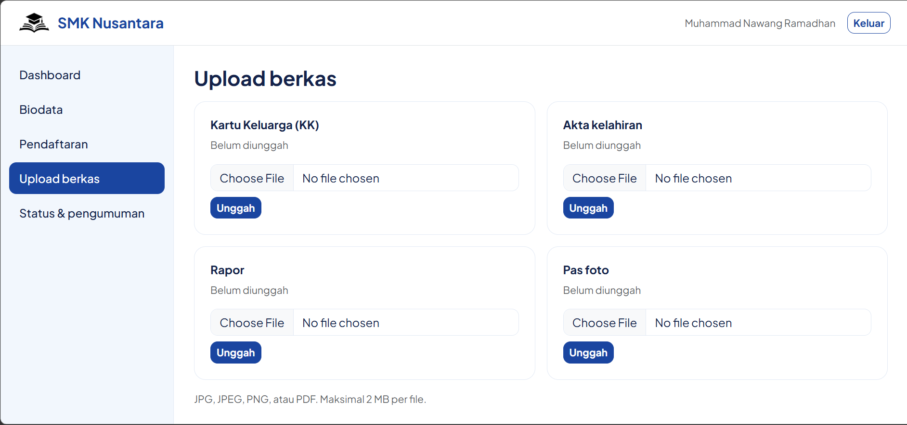

*Gambar 11. Unggah berkas persyaratan*

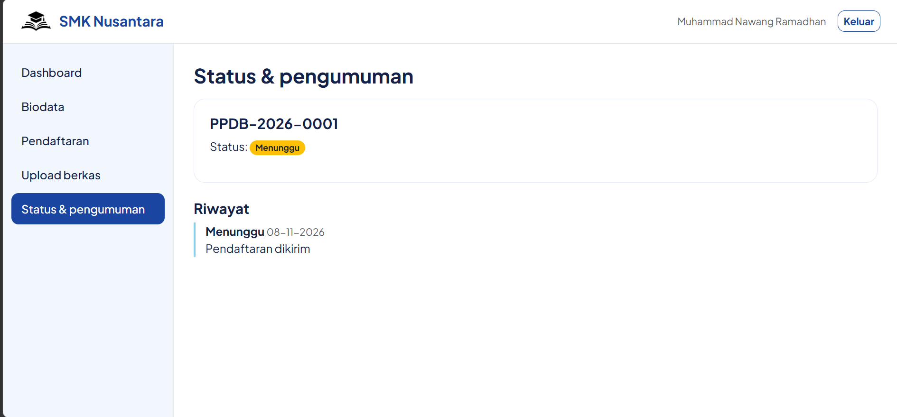

*Gambar 12. Status dan riwayat pendaftaran*

### D. Dashboard Admin

Admin masuk ke dashboard dengan menu samping (sidebar):

* **Dashboard** (`admin/dashboard.php`): menampilkan jumlah pendaftar per status (Menunggu, Diverifikasi, Diterima, Ditolak) dan penggunaan kuota setiap jurusan dalam bentuk progress bar.
* **Data siswa** (`admin/siswa.php`): daftar calon siswa dengan pencarian nama atau NISN dan tombol Hapus.
* **Data jurusan** (`admin/jurusan.php`): menambah, mengubah, mengaktifkan atau menonaktifkan jurusan, serta mengatur kuota.
* **Pendaftaran & verifikasi** (`admin/pendaftaran.php`): daftar pendaftar dengan pencarian dan filter status. Halaman detail menampilkan biodata, berkas yang diunggah, tombol perubahan status, kolom catatan, dan riwayat status.
* **Laporan** (`admin/laporan.php`): rekap pendaftar dengan filter jurusan dan status, jumlah berdasarkan jenis kelamin, serta ekspor ke CSV.
* **Pengaturan** (`admin/pengaturan.php`): tahun ajaran, tanggal pendaftaran dibuka dan ditutup, tanggal pengumuman, serta tombol untuk menampilkan hasil seleksi kepada siswa.

Aturan validasi dan proses pada sisi admin:

| Fitur         | Aturan                                                                                                  |
| ------------- | ------------------------------------------------------------------------------------------------------- |
| Alur status   | Menunggu → Diverifikasi → Diterima atau Ditolak; tombol "Minta perbaikan" mengembalikan status ke Menunggu |
| Penerimaan    | Hanya pendaftaran berstatus Diverifikasi yang dapat diterima                                            |
| Kuota         | Penerimaan ditolak jika jumlah siswa diterima sudah mencapai kuota jurusan                              |
| Riwayat       | Setiap perubahan status dicatat beserta catatan, nama admin, dan tanggal                                |
| Jurusan       | Kode, nama, dan kuota (minimal 1) wajib diisi; kode harus unik; kuota tidak boleh lebih kecil dari jumlah siswa diterima |
| Hapus siswa   | Siswa yang sudah memiliki pendaftaran tidak dapat dihapus                                               |
| Pengaturan    | Tahun ajaran berformat `2026/2027` dan tanggal tutup tidak boleh sebelum tanggal buka                   |

**Tangkapan layar:**

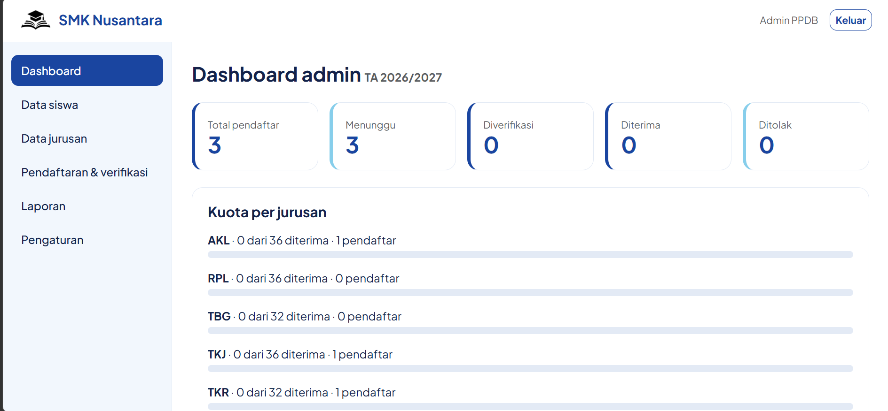

*Gambar 13. Dashboard admin*

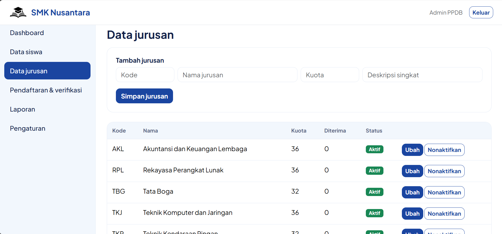

*Gambar 14. Pengelolaan data jurusan*

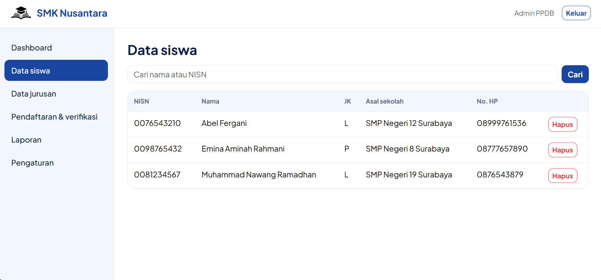

*Gambar 15. Daftar pendaftar dengan pencarian dan filter status*

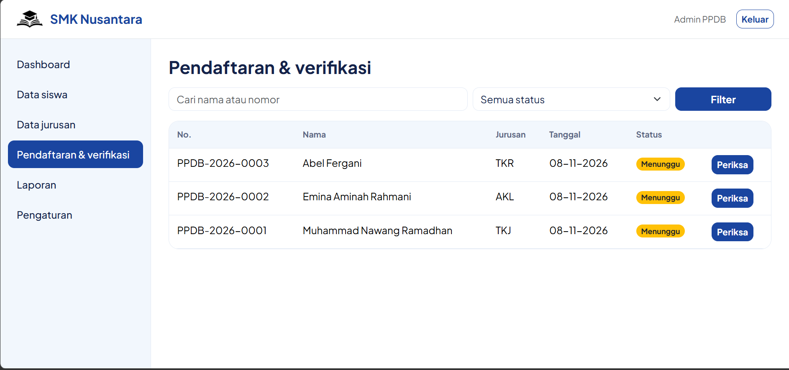

*Gambar 16. Detail pendaftar, perubahan status, dan riwayat*

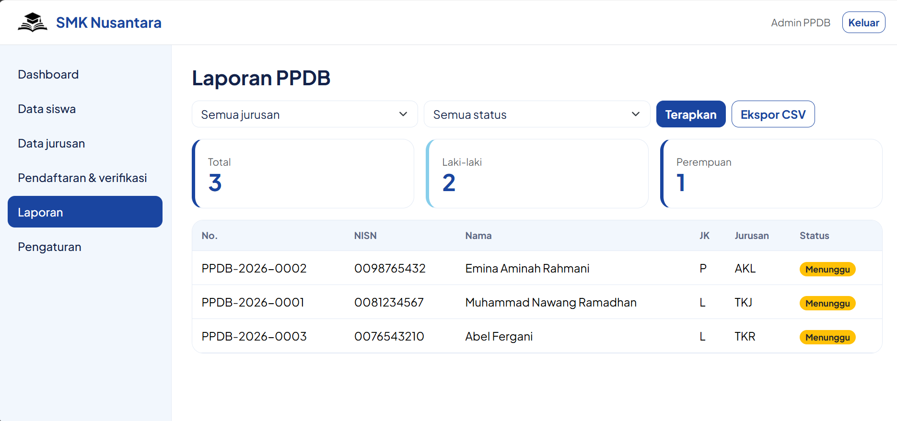

*Gambar 17. Laporan pendaftar dengan filter dan ekspor CSV*

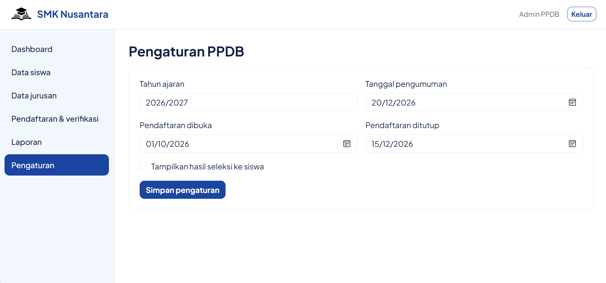

*Gambar 18. Pengaturan tahun ajaran dan periode PPDB*

### E. Tampilan Responsif

Seluruh halaman menyesuaikan ukuran layar menggunakan sistem grid Bootstrap. Pada layar besar, hero menampilkan teks di kiri dan foto di kanan. Pada layar kecil, navbar berubah menjadi tombol hamburger, foto hero menjadi latar tipis di belakang teks, sidebar dashboard berubah menjadi menu horizontal yang dapat digeser, dan tabel dapat digulir ke samping.

**Tangkapan layar:**

<p align="center">
  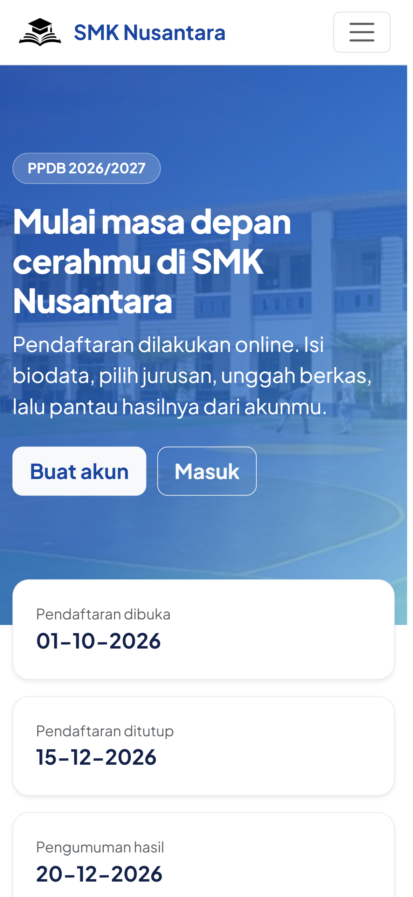
  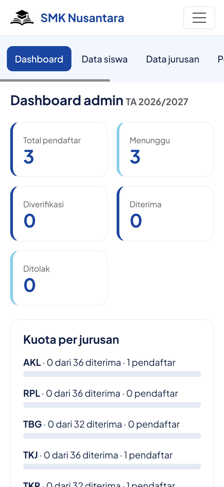
</p>

*Gambar 19. Tampilan beranda dan dashboard pada layar kecil*

### F. Keamanan

Beberapa langkah keamanan yang diterapkan:

* password disimpan dalam bentuk hash menggunakan `password_hash()` dan diperiksa dengan `password_verify()`;
* seluruh query database memakai **prepared statements (PDO)** untuk mencegah SQL injection;
* seluruh teks yang ditampilkan di-escape dengan `htmlspecialchars` untuk mencegah XSS;
* setiap form yang mengubah data dilindungi **token CSRF**;
* session dibuat ulang saat login (`session_regenerate_id`) dan dihapus saat logout;
* hak akses dibatasi berdasarkan role, sehingga siswa tidak dapat membuka halaman admin dan sebaliknya;
* unggahan berkas diperiksa ekstensi dan tipe MIME aslinya, dibatasi ukurannya, dan disimpan dengan nama acak;
* folder `uploads` dikunci dengan `.htaccess`, dan berkas hanya dapat dibuka melalui `file.php` oleh admin atau pemilik berkas;
* perubahan status dan pembuatan nomor pendaftaran memakai **transaksi database**.

## 4. Alur Penggunaan

Alur calon siswa:

```text
Membuka Halaman Beranda
          ↓
Membuat Akun (Registrasi)
          ↓
Login
          ↓
Mengisi Biodata
          ↓
Memilih Jurusan dan Mengirim Pendaftaran
          ↓
Menerima Nomor Pendaftaran
          ↓
Mengunggah Berkas Persyaratan
          ↓
Memantau Status Verifikasi
          ↓
Melihat Hasil Seleksi
```

Alur admin:

```text
Membuka Halaman Login
          ↓
Mengisi Email dan Password
          ↓
Data Divalidasi (server)
          ↓
Masuk ke Dashboard
          ↓
Memeriksa Biodata dan Berkas Pendaftar
          ↓
Verifikasi, lalu Terima atau Tolak (sesuai kuota)
          ↓
PHP Memvalidasi dan Menyimpan ke MySQL
          ↓
Mengaktifkan Pengumuman, Siswa Melihat Hasil
          ↓
Membuat Laporan dan Ekspor CSV
```

## 5. Struktur Halaman

| Halaman                  | Berkas                    | Fungsi                                              |
| ------------------------ | ------------------------- | --------------------------------------------------- |
| Beranda                  | `index.php`               | Informasi sekolah, jadwal, jurusan, dan persyaratan |
| Registrasi               | `register.php`            | Membuat akun calon siswa                            |
| Login                    | `login.php`               | Masuk admin dan calon siswa                         |
| Logout                   | `logout.php`              | Mengakhiri session                                  |
| Unduh berkas             | `file.php`                | Membuka berkas dengan pemeriksaan hak akses         |
| Dashboard siswa          | `siswa/dashboard.php`     | Ringkasan pendaftaran                               |
| Biodata                  | `siswa/biodata.php`       | Mengisi dan memperbarui biodata                     |
| Pendaftaran              | `siswa/pendaftaran.php`   | Memilih jurusan dan mengirim pendaftaran            |
| Upload berkas            | `siswa/berkas.php`        | Mengunggah dokumen persyaratan                      |
| Status & pengumuman      | `siswa/status.php`        | Status, riwayat, dan hasil seleksi                  |
| Cetak bukti              | `siswa/cetak.php`         | Bukti pendaftaran                                   |
| Dashboard admin          | `admin/dashboard.php`     | Statistik dan kuota                                 |
| Data siswa               | `admin/siswa.php`         | Melihat, mencari, dan menghapus siswa               |
| Data jurusan             | `admin/jurusan.php`       | CRUD jurusan dan kuota                              |
| Pendaftaran & verifikasi | `admin/pendaftaran.php`   | Daftar pendaftar, verifikasi, dan seleksi           |
| Laporan                  | `admin/laporan.php`       | Rekap, filter, dan ekspor CSV                       |
| Pengaturan               | `admin/pengaturan.php`    | Tahun ajaran, periode, dan pengumuman               |

Halaman verifikasi dan seleksi pada PRD digabung ke dalam `admin/pendaftaran.php` agar admin dapat memeriksa, memverifikasi, dan menentukan hasil dalam satu alur.

## 6. Struktur Database

Database bernama `db_ppdb_smk` memiliki tujuh tabel dengan mesin InnoDB dan karakter `utf8mb4`.

**Tabel `users`** (admin dan calon siswa)

| Field      | Tipe                    | Keterangan   |
| ---------- | ----------------------- | ------------ |
| id_user    | INT (PK, AI)            | ID pengguna  |
| nama       | VARCHAR(100)            | Nama lengkap |
| email      | VARCHAR(120), unik      | Nama login   |
| password   | VARCHAR(255)            | Hash         |
| role       | ENUM('admin','siswa')   | Hak akses    |
| created_at | TIMESTAMP               | Waktu dibuat |

**Tabel `siswa`**

| Field         | Tipe                        | Keterangan                |
| ------------- | --------------------------- | ------------------------- |
| id_siswa      | INT (PK, AI)                | ID siswa                  |
| id_user       | INT (FK → users.id_user), unik | Pemilik biodata        |
| nisn          | CHAR(10), unik              | Nomor induk siswa nasional |
| nama_lengkap  | VARCHAR(100)                | Nama siswa                |
| jenis_kelamin | ENUM('L','P')               | Jenis kelamin             |
| tempat_lahir  | VARCHAR(60)                 | Tempat lahir              |
| tanggal_lahir | DATE                        | Tanggal lahir             |
| alamat        | TEXT                        | Alamat                    |
| asal_sekolah  | VARCHAR(100)                | Asal SMP/MTs              |
| no_hp         | VARCHAR(15)                 | Nomor HP                  |

**Tabel `jurusan`**

| Field        | Tipe               | Keterangan          |
| ------------ | ------------------ | ------------------- |
| id_jurusan   | INT (PK, AI)       | ID jurusan          |
| kode_jurusan | VARCHAR(10), unik  | Kode (RPL, TKJ, dst.) |
| nama_jurusan | VARCHAR(100)       | Nama jurusan        |
| kuota        | INT                | Kuota penerimaan    |
| deskripsi    | VARCHAR(255)       | Deskripsi singkat   |
| aktif        | TINYINT(1)         | 1 aktif, 0 nonaktif |

**Tabel `pendaftaran`**

| Field          | Tipe                                           | Keterangan                    |
| -------------- | ---------------------------------------------- | ----------------------------- |
| id_pendaftaran | INT (PK, AI)                                   | ID pendaftaran                |
| no_pendaftaran | VARCHAR(20), unik                              | Nomor pendaftaran             |
| id_siswa       | INT (FK → siswa.id_siswa)                      | Pendaftar                     |
| id_jurusan     | INT (FK → jurusan.id_jurusan)                  | Jurusan pilihan               |
| tahun_ajaran   | VARCHAR(9)                                     | Contoh 2026/2027              |
| tanggal_daftar | DATETIME                                       | Waktu mendaftar               |
| status         | ENUM('Menunggu','Diverifikasi','Diterima','Ditolak') | Status pendaftaran      |
| catatan        | TEXT                                           | Catatan admin terakhir        |

**Tabel `berkas`**

| Field          | Tipe                              | Keterangan                       |
| -------------- | --------------------------------- | -------------------------------- |
| id_berkas      | INT (PK, AI)                      | ID berkas                        |
| id_pendaftaran | INT (FK → pendaftaran.id_pendaftaran) | Pendaftaran terkait          |
| jenis_berkas   | VARCHAR(30)                       | KK, AKTA, RAPOR, atau FOTO       |
| nama_file      | VARCHAR(80)                       | Nama file acak di server         |
| nama_asli      | VARCHAR(150)                      | Nama file asli                   |
| tanggal_upload | DATETIME                          | Waktu unggah                     |

**Tabel `riwayat_status`**

| Field             | Tipe                                  | Keterangan               |
| ----------------- | ------------------------------------- | ------------------------ |
| id_riwayat        | INT (PK, AI)                          | ID riwayat               |
| id_pendaftaran    | INT (FK → pendaftaran.id_pendaftaran) | Pendaftaran terkait      |
| status_sebelumnya | VARCHAR(20)                           | Status lama              |
| status_baru       | VARCHAR(20)                           | Status baru              |
| catatan           | TEXT                                  | Catatan perubahan        |
| id_admin          | INT (FK → users.id_user), boleh kosong | Admin yang mengubah     |
| tanggal_perubahan | DATETIME                              | Waktu perubahan          |

**Tabel `pengaturan`** (tabel tambahan di luar enam tabel pada PRD)

| Field | Tipe             | Keterangan                                                           |
| ----- | ---------------- | -------------------------------------------------------------------- |
| kunci | VARCHAR(30) (PK) | tahun_ajaran, buka, tutup, tgl_pengumuman, pengumuman_aktif          |
| nilai | VARCHAR(100)     | Nilai pengaturan                                                     |

Relasi antartabel:

```text
users (1) ──── (1) siswa (1) ────< (N) pendaftaran (N) >──── (1) jurusan
                                         │
                                         ├────< (N) berkas
                                         └────< (N) riwayat_status (N) >──── (1) users (admin)
```

Satu akun memiliki satu biodata, satu siswa dapat memiliki pendaftaran (satu per tahun ajaran), satu jurusan dapat dipilih banyak pendaftaran, dan satu pendaftaran dapat memiliki banyak berkas dan riwayat status. Berkas, riwayat, dan biodata ikut terhapus saat induknya dihapus (`ON DELETE CASCADE`), sedangkan siswa dan jurusan yang sudah memiliki pendaftaran tidak dapat dihapus (`ON DELETE RESTRICT`). Kombinasi `id_siswa` dan `tahun_ajaran` unik, begitu pula kombinasi `id_pendaftaran` dan `jenis_berkas`.

Berkas ekspor database yang berisi struktur tabel, data jurusan, pengaturan awal, dan akun admin tersedia pada `database.sql`.

## 7. Arsitektur 3 Tier

| Lapisan                            | Teknologi                      | Peran                                                                                         |
| ---------------------------------- | ------------------------------ | --------------------------------------------------------------------------------------------- |
| Presentation Layer                 | HTML, CSS, Bootstrap 5, JavaScript | Tampilan halaman, layout responsif, dan validasi dasar sisi klien                         |
| Application Layer (Business Logic) | PHP                            | Autentikasi, session, otorisasi role, CRUD, aturan kuota, unggah berkas, dan validasi server  |
| Data Layer                         | MySQL (PDO)                    | Penyimpanan pengguna, biodata, jurusan, pendaftaran, berkas, riwayat, dan pengaturan          |

## 8. Struktur File

```text
ppdb_smk/
├── index.php             # beranda
├── login.php             # halaman login
├── register.php          # halaman registrasi
├── logout.php            # keluar
├── file.php              # unduh berkas dengan otorisasi
├── database.sql          # hasil ekspor struktur dan data awal database
├── config/
│   └── database.php      # koneksi database (PDO)
├── includes/
│   ├── functions.php     # fungsi bantu, session, CSRF, otorisasi, dan perubahan status
│   └── layout.php        # navbar, sidebar, dan footer
├── siswa/
│   ├── dashboard.php     # ringkasan pendaftaran
│   ├── biodata.php       # form biodata
│   ├── pendaftaran.php   # pemilihan jurusan
│   ├── berkas.php        # unggah berkas
│   ├── status.php        # status dan pengumuman
│   └── cetak.php         # bukti pendaftaran
├── admin/
│   ├── dashboard.php     # statistik dan kuota
│   ├── siswa.php         # data siswa
│   ├── jurusan.php       # CRUD jurusan
│   ├── pendaftaran.php   # verifikasi dan seleksi
│   ├── laporan.php       # laporan dan ekspor CSV
│   └── pengaturan.php    # pengaturan PPDB
├── assets/
│   ├── css/style.css     # warna tema dan gaya tampilan
│   └── images/           # logo.png dan hero.jpg
├── uploads/              # berkas siswa (dikunci .htaccess)
├── screenshots/          # tangkapan layar untuk dokumentasi
└── README.md             # dokumentasi proyek
```

## 9. Teknologi yang Digunakan

Website dikembangkan menggunakan:

* **HTML**: untuk membangun struktur halaman;
* **CSS**: untuk palet warna, efek foto hero yang menyatu dengan latar, dan penyesuaian tampilan di atas Bootstrap;
* **Bootstrap 5.3.3**: untuk sistem grid, komponen, dan tampilan responsif;
* **JavaScript**: untuk bagian interaktif bawaan Bootstrap (menu hamburger dan notifikasi yang dapat ditutup) serta fitur cetak bukti;
* **PHP**: untuk logika aplikasi, autentikasi, CRUD, dan pengolahan unggahan;
* **MySQL dan PDO**: untuk penyimpanan data, dikelola melalui phpMyAdmin;
* **XAMPP (Apache dan MySQL)**: untuk menjalankan website di komputer lokal;
* **Google Fonts**: untuk jenis huruf Plus Jakarta Sans;
* **Visual Studio Code**: untuk penulisan kode.

## 10. Menjalankan Website

Website dijalankan secara lokal menggunakan XAMPP:

1. Jalankan **Apache** dan **MySQL** dari XAMPP Control Panel.
2. Salin folder `ppdb_smk` ke `C:\xampp\htdocs\`.
3. Buka `http://localhost/phpmyadmin`, lalu klik tab **Import**, pilih berkas `database.sql`, dan klik **Import**. Database `db_ppdb_smk` beserta tabelnya akan terbentuk.
4. Buka `config/database.php` dan sesuaikan `DB_USER` dan `DB_PASS` jika berbeda (secara bawaan `root` dan kosong). Jika nama folder bukan `ppdb_smk`, ubah `BASE_URL` pada `includes/functions.php`.
5. Letakkan `logo.png` dan `hero.jpg` pada folder `assets/images/`.
6. Buka `http://localhost/ppdb_smk/` untuk beranda.
7. Buka `http://localhost/ppdb_smk/login.php` untuk masuk.

Website memerlukan koneksi internet karena Bootstrap dan jenis huruf dimuat melalui CDN.

Akun untuk uji coba:

| Email                 | Password   | Role         |
| --------------------- | ---------- | ------------ |
| `admin@smk.id`        | `admin123` | Admin        |
| `nawangramadhan@gmai.com` | `nawang123`    | Calon siswa  |
| `eminaminah@gmail.com` | `emina123`    | Calon siswa  |
| `abelfergani@gmail.com` | `abel123`   | Calon siswa  |

Password akun admin bawaan sebaiknya segera diganti setelah aplikasi dipakai.

## 11. Pengujian

Pengujian dilakukan secara manual berdasarkan *Acceptance Criteria* pada PRD. 

| No | Pengujian         | Kriteria Keberhasilan              | Hasil |
| -- | ----------------- | ---------------------------------- | ----- |
| 1  | Registrasi        | Akun berhasil disimpan ke MySQL    | ✅     |
| 2  | Login             | Pengguna diarahkan sesuai role     | ✅     |
| 3  | Biodata           | Data siswa berhasil disimpan       | ✅     |
| 4  | Pemilihan jurusan | Jurusan tersedia dan dapat dipilih | ✅     |
| 5  | Pendaftaran       | Nomor pendaftaran berhasil dibuat  | ✅     |
| 6  | Upload berkas     | Dokumen valid berhasil diunggah    | ✅     |
| 7  | Verifikasi        | Admin dapat mengubah status        | ✅     |
| 8  | Pengumuman        | Siswa dapat melihat hasil seleksi  | ✅     |
| 9  | Dashboard         | Statistik sesuai data database     | ✅     |
| 10 | Laporan           | Data dapat difilter dan diekspor   | ✅     |

## 12. Dokumentasi

Website ini belum di-deploy ke hosting publik. Sebagai gantinya, seluruh halaman didokumentasikan melalui tangkapan layar pada folder `screenshots/`, sedangkan struktur dan data awal database disimpan pada berkas `database.sql` sehingga website dapat dijalankan ulang di komputer lain dengan XAMPP.

Hal yang belum termasuk dalam ruang lingkup MVP: pembayaran online, integrasi Dapodik dan layanan eksternal, ekspor laporan ke format Excel (.xlsx) dan PDF (saat ini CSV yang dapat dibuka di Excel), serta lebih dari satu pilihan jurusan per siswa.

## 13. Kredit

* Rancangan dan spesifikasi sistem: dokumen *Product Requirements Document PPDB Online SMK Nusantara* pada mata kuliah Web Back End.
* Palet warna: referensi gambar *Education & Learning Gradient Palette*.
* Foto hero: Didapatkan dari Internet.
* Logo: Didapatkan dari Internet.
* Jenis huruf: Plus Jakarta Sans melalui Google Fonts.
* Framework: Bootstrap 5.3.3.
