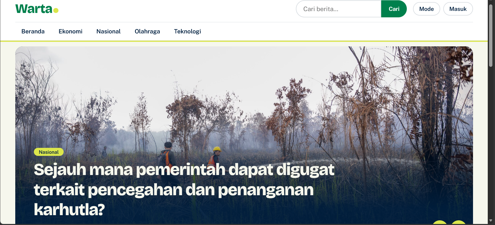
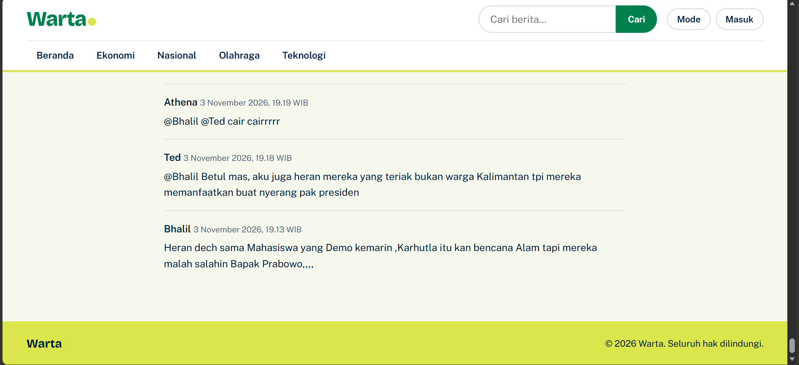

# Warta: Website News Portal

**Warta** adalah website portal berita online yang memungkinkan pengunjung membaca berita tanpa login, sedangkan admin dan editor mengelola berita, kategori, dan pengguna melalui dashboard. Website ini dibuat sebagai tugas proyek pembuatan aplikasi web dengan arsitektur tiga lapis (3 tier), yaitu HTML/CSS/JavaScript sebagai lapisan tampilan, PHP sebagai lapisan logika bisnis, dan MySQL sebagai lapisan data.

Tampilan Warta mengusung suasana terang, modern, dan bersemangat untuk mendorong pembaca terus menelusuri informasi tentang dunia, dengan warna putih gading, hijau, dan aksen hijau limau yang segar.

## 1. Tujuan

Website ini dibuat untuk:

* menerapkan arsitektur 3 tier (Presentation Layer, Application Layer, dan Data Layer) dalam satu aplikasi web;
* menyediakan halaman berita untuk pengguna umum, meliputi beranda, detail berita, kategori, dan pencarian;
* menyediakan dashboard admin untuk mengelola berita (CRUD), kategori, dan pengguna;
* menerapkan autentikasi, manajemen session, validasi form, serta unggah gambar yang aman;
* menyimpan seluruh data berita pada database MySQL dengan relasi antartabel;
* menghasilkan tampilan website yang terang, modern, responsif, dan nyaman untuk membaca.

## 2. Konsep dan Tema

Konsep Warta adalah portal berita yang cepat dibaca dan enak dilihat. Nama **"Warta"** dipilih karena berarti kabar atau berita. Judul berita dibuat besar dan tegas, sedangkan aksen hijau limau dipakai sebagai penanda perhatian, misalnya pada label kategori, sorotan kalimat penting, dan footer.

Palet warna yang digunakan:

| Warna                  | Kode      | Penggunaan                                              |
| ---------------------- | --------- | ------------------------------------------------------- |
| Praxeti White          | `#F6F7ED` | Latar halaman                                           |
| Midnight Mirage        | `#001F3F` | Teks utama dan latar mode gelap                         |
| First Colors of Spring | `#DBE64C` | Aksen: label kategori, sorotan, garis judul, footer     |
| Mantis                 | `#74C365` | Penanda fokus keyboard dan aksen pada mode gelap        |
| Picture Book Green     | `#00804C` | Logo, tombol, dan nomor halaman aktif                   |
| Nuit Blanche           | `#1E488F` | Tautan, hover tombol, dan latar gambar kosong           |

Jenis huruf yang digunakan adalah **Bricolage Grotesque** untuk judul dan **Public Sans** untuk teks isi.

## 3. Fitur Website

### A. Halaman Pengguna Umum

Halaman yang dapat diakses tanpa login:

* **Beranda** (`index.php`): berisi navbar dengan kolom pencarian dan menu kategori, slider berita utama (maksimal 5 berita terbaru yang memiliki gambar), daftar berita terbaru dengan pagination (9 berita per halaman), serta blok sorotan yang menampilkan 3 berita terbaru dari setiap kategori.
* **Detail Berita** (`news.php`): menampilkan judul, kategori, penulis, tanggal terbit, estimasi waktu baca, gambar utama, isi berita, kolom komentar, dan tiga berita terkait dari kategori yang sama.
* **Kategori** (`category.php`): menampilkan daftar berita berdasarkan kategori yang dipilih, lengkap dengan pagination.
* **Pencarian** (`search.php`): menampilkan hasil pencarian berdasarkan kata kunci pada judul dan isi berita.
* **Mode Terang/Gelap**: tombol "Mode" pada navbar untuk mengganti tema. Pilihan pengguna disimpan di browser, dan tampilan awal selalu terang.
* **API JSON** (`api/news.php`): endpoint opsional yang menghasilkan daftar berita dalam format JSON dan dapat difilter berdasarkan kategori, kata kunci, dan halaman.

**Tangkapan layar:**



*Gambar 1. Bagian navbar dan slider berita utama*


*Gambar 2. Daftar berita terbaru dan blok sorotan per kategori*


*Gambar 3. Halaman detail berita dengan subjudul, kutipan besar, dan gambar di tengah isi*



*Gambar 4. Kolom komentar dan berita terkait*


*Gambar 5. Halaman berita berdasarkan kategori (pada admin)*


*Gambar 6. Halaman hasil pencarian*


*Gambar 7. Tampilan mode gelap*

### B. Format Penulisan Isi Berita

Isi berita ditulis sebagai teks biasa, lalu diberi penanda sederhana agar tampil sebagai headline, kalimat penting, atau gambar. Seluruh teks di-escape terlebih dahulu sebelum penanda diproses sehingga aman dari penyisipan HTML.

| Penanda                  | Hasil pada halaman berita                      |
| ------------------------ | ---------------------------------------------- |
| `## Judul bagian`        | Subjudul besar dengan garis hijau limau di kiri |
| `> Kalimat penting`      | Kotak kutipan besar berlatar hijau limau        |
| `==kalimat==`            | Sorotan (stabilo) hijau limau                   |
| `**kalimat**`            | Teks tebal                                      |
| `*kalimat*`              | Teks miring                                     |
| `` | Gambar di tengah isi berita beserta keterangan |

Gambar di tengah isi diunggah melalui kotak "Sisipkan gambar ke isi berita" pada form berita. Setelah diunggah, baris penanda gambar otomatis muncul di posisi kursor sehingga gambar dapat ditempatkan di antara paragraf mana pun.

### C. Halaman Login

Halaman login (`admin/login.php`) digunakan admin dan editor untuk masuk ke dashboard. Halaman ini berisi kolom **Username**, kolom **Password**, tombol **Masuk**, dan tautan kembali ke beranda.

Aturan validasi pada halaman login:

| Kolom    | Aturan                                                                 |
| -------- | ---------------------------------------------------------------------- |
| Username | Wajib diisi                                                            |
| Password | Wajib diisi, minimal 6 karakter (validasi klien); dicocokkan dengan hash bcrypt di database (validasi server) |

Validasi sisi klien dilakukan dengan JavaScript sehingga kolom yang bermasalah diberi tanda merah sebelum form dikirim. Setelah lolos, server memeriksa akun dan membuat session baru.

**Tangkapan layar:**


*Gambar 8. Halaman login*


*Gambar 9. Pesan kesalahan pada halaman login*

### D. Dashboard Admin dan Editor

Setelah login, pengguna masuk ke dashboard dengan menu samping (sidebar). Hak akses dibedakan berdasarkan level pengguna.

* **Dashboard** (`admin/index.php`): menampilkan jumlah berita terbit, draf, kategori, dan komentar, serta daftar enam berita yang terakhir diubah.
* **Berita** (`admin/news.php`): daftar seluruh berita dengan status, penulis, dan tanggal terbit, lengkap dengan tombol Edit dan Hapus. Admin dapat mengelola semua berita, sedangkan editor hanya dapat mengelola berita yang ia tulis sendiri.
* **Form Berita** (`admin/news_form.php`): form untuk menambah dan mengubah berita, berisi judul, kategori, status (Draf/Terbit), waktu terbit, gambar utama, kotak sisip gambar, dan isi berita.
* **Kategori** (`admin/categories.php`): menambah, mengubah, dan menghapus kategori. Kategori yang masih dipakai berita tidak dapat dihapus.
* **Pengguna** (`admin/users.php`): khusus admin; menambah pengguna, mengubah level (admin/editor), mereset password, dan menghapus pengguna.

Aturan validasi pada form berita:

| Kolom         | Aturan                                                  |
| ------------- | ------------------------------------------------------- |
| Judul         | Wajib diisi, maksimal 200 karakter                      |
| Kategori      | Wajib dipilih dari daftar kategori yang tersedia         |
| Isi berita    | Wajib diisi                                             |
| Status        | Draf atau Terbit                                        |
| Waktu terbit  | Opsional; jika kosong memakai waktu saat berita diterbitkan |
| Gambar        | Opsional; format JPG, PNG, atau WEBP; maksimal 2 MB     |

Aturan validasi pada kolom komentar dan pengguna:

| Form      | Aturan                                                                                       |
| --------- | -------------------------------------------------------------------------------------------- |
| Komentar  | Nama wajib diisi, email wajib valid, komentar wajib diisi dan maksimal 1000 karakter          |
| Kategori  | Nama wajib diisi                                                                             |
| Pengguna  | Username 3–50 karakter (huruf, angka, titik, garis bawah), nama lengkap wajib, password minimal 6 karakter |

**Tangkapan layar:**


*Gambar 10. Dashboard admin*


*Gambar 11. Daftar berita pada dashboard*


*Gambar 12. Form tambah atau ubah berita*


*Gambar 13. Pengelolaan kategori*


*Gambar 14. Pengelolaan pengguna (khusus admin)*

### E. Tampilan Responsif

Seluruh halaman menyesuaikan ukuran layar menggunakan CSS Grid dan Flexbox. Pada layar besar, daftar berita tersusun dalam beberapa kolom. Pada layar kecil, kartu berita tersusun ke bawah, kolom pencarian pindah ke baris sendiri, menu kategori dapat digeser ke samping, dan sidebar dashboard berubah menjadi menu horizontal.

**Tangkapan layar:**

![Gambar 15. Tampilan layar kecil]
<p align="center">
  
</p>

*Gambar 15. Tampilan beranda dan detail berita pada layar kecil*

### F. Keamanan

Beberapa langkah keamanan yang diterapkan:

* password disimpan dalam bentuk hash **bcrypt**, bukan teks asli;
* seluruh query database memakai **prepared statements (PDO)** untuk mencegah SQL injection;
* seluruh teks yang ditampilkan di-escape dengan `htmlspecialchars` untuk mencegah XSS;
* setiap form yang mengubah data dilindungi **token CSRF**;
* session dibuat ulang saat login (`session_regenerate_id`) dan dihapus saat logout;
* unggahan gambar diperiksa tipe MIME-nya, dibatasi ukurannya, dan diberi nama acak;
* folder `uploads` dilengkapi `.htaccess` yang melarang eksekusi skrip PHP.

## 4. Alur Penggunaan

Alur pengguna umum:

```text
Membuka Halaman Beranda
          ↓
Melihat Slider, Berita Terbaru, dan Sorotan Kategori
          ↓
Memilih Berita / Kategori / Mencari dengan Kata Kunci
          ↓
Membaca Detail Berita
          ↓
Menulis Komentar (opsional)
```

Alur admin dan editor:

```text
Membuka /admin/login.php
          ↓
Mengisi Username dan Password
          ↓
Data Divalidasi (klien dan server)
          ↓
Masuk ke Dashboard
          ↓
Mengelola Berita / Kategori / Pengguna
          ↓
PHP Memvalidasi dan Menyimpan ke MySQL
          ↓
Halaman Pengguna Otomatis Menampilkan Data Terbaru
```

## 5. Struktur Halaman

| Halaman          | Berkas                  | Fungsi                                              |
| ---------------- | ----------------------- | --------------------------------------------------- |
| Beranda          | `index.php`             | Slider, berita terbaru, dan sorotan kategori        |
| Detail Berita    | `news.php`              | Isi berita, komentar, dan berita terkait            |
| Kategori         | `category.php`          | Daftar berita per kategori                          |
| Pencarian        | `search.php`            | Hasil pencarian berita                              |
| Login            | `admin/login.php`       | Masuk admin dan editor                              |
| Logout           | `admin/logout.php`      | Mengakhiri session                                  |
| Dashboard        | `admin/index.php`       | Ringkasan data                                      |
| Daftar Berita    | `admin/news.php`        | Melihat dan menghapus berita                        |
| Form Berita      | `admin/news_form.php`   | Menambah dan mengubah berita                        |
| Unggah Gambar    | `admin/upload_inline.php` | Unggah gambar untuk isi berita (respons JSON)     |
| Kategori         | `admin/categories.php`  | CRUD kategori                                       |
| Pengguna         | `admin/users.php`       | Manajemen pengguna (khusus admin)                   |
| API Berita       | `api/news.php`          | Respons JSON daftar berita                          |

## 6. Struktur Database

Database bernama `news_portal` memiliki empat tabel dengan mesin InnoDB dan karakter `utf8mb4`.

**Tabel `users`** (admin dan editor)

| Field      | Tipe                        | Keterangan          |
| ---------- | --------------------------- | ------------------- |
| id         | INT (PK, AI)                | ID pengguna         |
| username   | VARCHAR(50), unik           | Nama login          |
| password   | VARCHAR(255)                | Hash bcrypt         |
| fullname   | VARCHAR(100)                | Nama lengkap        |
| role       | ENUM('admin','editor')      | Hak akses           |
| created_at | DATETIME                    | Waktu dibuat        |

**Tabel `categories`**

| Field       | Tipe             | Keterangan        |
| ----------- | ---------------- | ----------------- |
| id          | INT (PK, AI)     | ID kategori       |
| name        | VARCHAR(100)     | Nama kategori     |
| slug        | VARCHAR(120), unik | Slug untuk URL  |
| description | TEXT             | Deskripsi         |

**Tabel `news`**

| Field        | Tipe                          | Keterangan                    |
| ------------ | ----------------------------- | ----------------------------- |
| id           | INT (PK, AI)                  | ID berita                     |
| category_id  | INT (FK → categories.id)      | Kategori berita               |
| title        | VARCHAR(200)                  | Judul berita                  |
| slug         | VARCHAR(220), unik            | Slug untuk URL                |
| content      | TEXT                          | Isi berita                    |
| image        | VARCHAR(255)                  | Nama file gambar utama        |
| author_id    | INT (FK → users.id)           | Penulis                       |
| published_at | DATETIME                      | Waktu terbit                  |
| status       | ENUM('draft','published')     | Status berita                 |
| created_at   | DATETIME                      | Waktu dibuat                  |
| updated_at   | DATETIME                      | Waktu diubah                  |

**Tabel `comments`**

| Field      | Tipe                      | Keterangan         |
| ---------- | ------------------------- | ------------------ |
| id         | INT (PK, AI)              | ID komentar        |
| news_id    | INT (FK → news.id)        | Berita yang dikomentari |
| name       | VARCHAR(100)              | Nama pengomentar   |
| email      | VARCHAR(150)              | Email pengomentar  |
| comment    | TEXT                      | Isi komentar       |
| created_at | DATETIME                  | Waktu komentar     |

Relasi antartabel:

```text
users (1) ────────< (N) news (N) >──────── (1) categories
                         │
                         └──────< (N) comments
```

Satu kategori dapat memiliki banyak berita, satu pengguna dapat menulis banyak berita, dan satu berita dapat memiliki banyak komentar. Komentar ikut terhapus ketika beritanya dihapus (`ON DELETE CASCADE`), sedangkan kategori dan pengguna yang masih memiliki berita tidak dapat dihapus (`ON DELETE RESTRICT`).

Berkas ekspor database yang berisi struktur tabel beserta data berita tersedia pada `news_portal.sql`.

## 7. Arsitektur 3 Tier

| Lapisan                          | Teknologi              | Peran                                                                 |
| -------------------------------- | ---------------------- | --------------------------------------------------------------------- |
| Presentation Layer               | HTML, CSS, JavaScript  | Tampilan halaman, slider, mode gelap, dan validasi form sisi klien     |
| Application Layer (Business Logic) | PHP                  | Autentikasi, session, CRUD, unggah gambar, validasi server, dan API JSON |
| Data Layer                       | MySQL                  | Penyimpanan pengguna, kategori, berita, dan komentar                   |

## 8. Struktur File

```text
newsportal/
├── index.php             # beranda
├── news.php              # detail berita
├── category.php          # halaman kategori
├── search.php            # halaman pencarian
├── config.php            # pengaturan database dan situs
├── includes/
│   ├── db.php            # koneksi database (PDO)
│   ├── functions.php     # fungsi bantu, query berita, dan penerjemah penanda isi berita
│   ├── header.php        # kepala halaman pengguna
│   └── footer.php        # kaki halaman pengguna
├── admin/
│   ├── _layout.php       # kerangka dashboard dan pengecekan login
│   ├── login.php         # halaman login
│   ├── logout.php        # keluar
│   ├── index.php         # dashboard
│   ├── news.php          # daftar berita
│   ├── news_form.php     # form tambah/ubah berita
│   ├── upload_inline.php # unggah gambar isi berita
│   ├── categories.php    # kelola kategori
│   └── users.php         # kelola pengguna
├── api/
│   └── news.php          # API JSON
├── assets/
│   ├── css/style.css     # warna tema dan gaya tampilan
│   └── js/main.js        # slider, mode gelap, dan validasi form
├── uploads/              # gambar berita yang diunggah
├── screenshots/          # tangkapan layar untuk dokumentasi
├── news_portal.sql       # hasil ekspor database
└── README.md             # dokumentasi proyek
```

## 9. Teknologi yang Digunakan

Website dikembangkan menggunakan:

* **HTML**: untuk membangun struktur halaman;
* **CSS**: untuk palet warna, tata letak (Grid dan Flexbox), mode terang/gelap, dan tampilan responsif;
* **JavaScript**: untuk slider berita, tombol mode terang/gelap, validasi form sisi klien, dan unggah gambar isi berita tanpa memuat ulang halaman;
* **PHP**: untuk logika aplikasi, autentikasi, CRUD, dan pengolahan unggahan;
* **MySQL**: untuk penyimpanan data, dikelola melalui phpMyAdmin;
* **XAMPP (Apache dan MySQL)**: untuk menjalankan website di komputer lokal;
* **Google Fonts**: untuk jenis huruf Bricolage Grotesque dan Public Sans;
* **Visual Studio Code**: untuk penulisan kode.

## 10. Menjalankan Website

Website dijalankan secara lokal menggunakan XAMPP:

1. Jalankan **Apache** dan **MySQL** dari XAMPP Control Panel.
2. Salin folder `newsportal` ke `C:\xampp\htdocs\`.
3. Buka `http://localhost/phpmyadmin`, lalu klik tab **Import**, pilih berkas `news_portal.sql`, dan klik **Import**. Database `news_portal` beserta empat tabelnya akan terbentuk.
4. Buka `config.php` dan sesuaikan `DB_USER`, `DB_PASS`, dan `BASE_URL` (secara bawaan `root`, kosong, dan `/newsportal`).
5. Buka `http://localhost/newsportal/` untuk halaman pengguna.
6. Buka `http://localhost/newsportal/admin/login.php` untuk masuk ke dashboard.

Website memerlukan koneksi internet karena jenis huruf dimuat dari Google Fonts.

Akun awal untuk uji coba:

| Username | Password   | Level |
| -------- | ---------- | ----- |
| admin    | admin123   | Admin |

Password akun awal sebaiknya segera diganti melalui menu **Pengguna** pada dashboard.

## 11. Dokumentasi

Website ini belum di-deploy ke hosting publik. Sebagai gantinya, seluruh halaman didokumentasikan melalui tangkapan layar pada folder `screenshots/`, sedangkan data berita disimpan pada berkas `news_portal.sql` sehingga website dapat dijalankan ulang di komputer lain dengan XAMPP.

## 12. Kredit

* Rancangan dan spesifikasi sistem News Portal: materi *Spesifikasi Aplikasi Web News Portal* oleh Fajar Baskoro (fajarbaskoro.blogspot.com).
* Palet warna: referensi palet "MP076" oleh Alex Cristache.
* Jenis huruf: Bricolage Grotesque dan Public Sans melalui Google Fonts.
* Contoh isi berita: *saya menggunakan artikel dari BBC News Indonesia sebagai bahan uji coba tampilan, dan seluruh hak cipta tetap milik penulis dan penerbit aslinya*.
* Gambar berita: *(isi sumber gambar yang kamu pakai, misalnya milik pribadi, Unsplash, atau Pexels)*.
